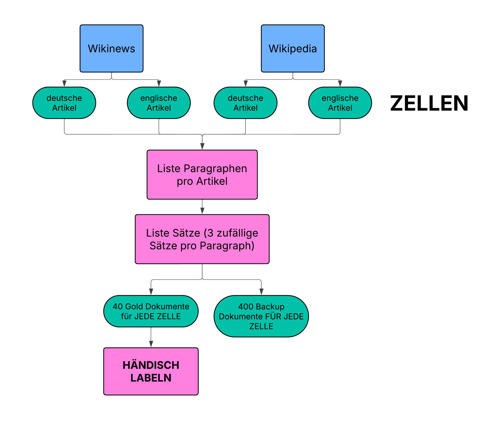
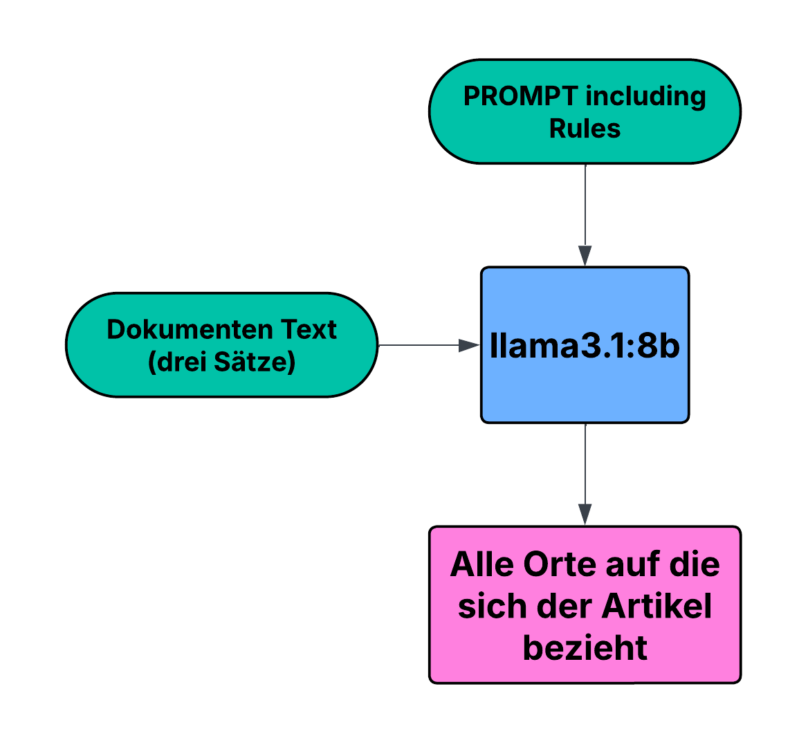
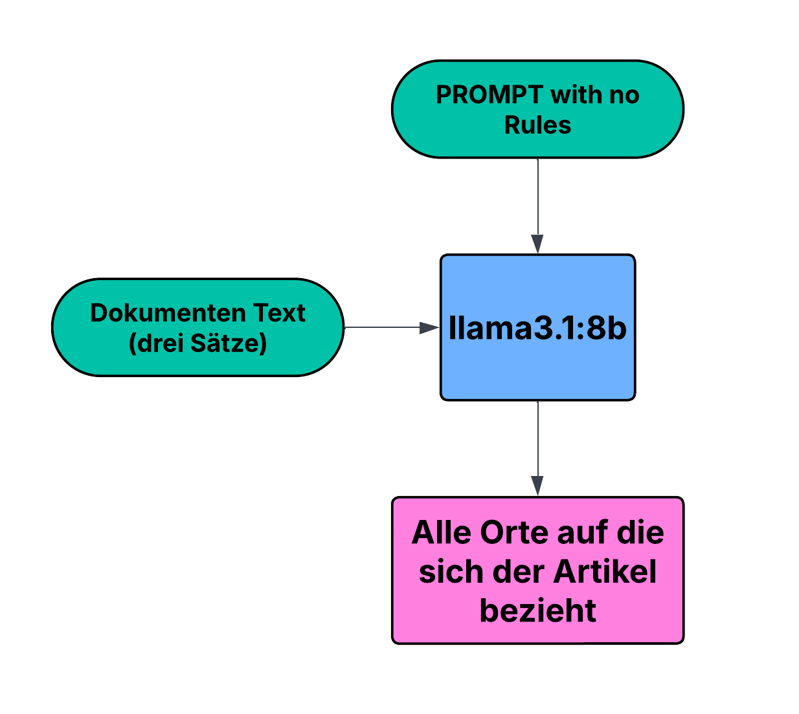
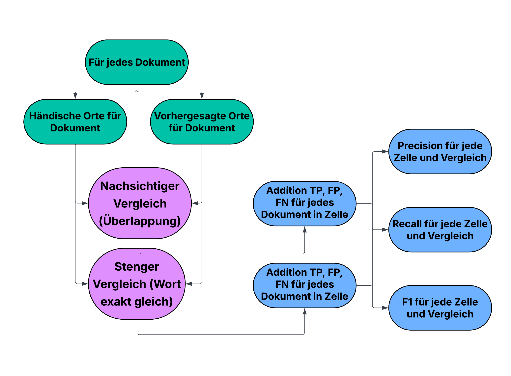

# Geo-Pipeline

Dieses Projekt evaluiert ein lokales Ollama Model (llama3.1:8b), geografische Orte aus Texten zu filtern. Um die Performance zu bewerten, werden die Resultate gegen einen eigenen menschlich gelabelten Datensatz verglichen.

## Dataset Übersicht

Artikel wurden hierbei anhand von Paragraphen getrennt und für jeden Paragraphen formen drei zufällige Sätze ein Dokument.



Es werden zwei Datensätze in vier Zellen verwendet:

- wikimedia/wikipedia in [Deutsch, Englisch]
- Fumika/Wikinews-multilingual [Deutsch, Englisch]

## Händisches Labeling

Diese vier Zellen wurden händisch gelabelt (40 Dokumente pro Zelle):

| Dataset | Documents | Excluded | Gold Spans | No Place | Figurative | Unsure | Historical |
|:--|--:|--:|--:|--:|--:|--:|--:|
| de/news | 40 | 0 | 67 | 16 | 6 | 0 | 0 |
| de/wikipedia | 40 | 0 | 36 | 23 | 8 | 2 | 0 |
| en/news | 40 | 0 | 63 | 18 | 0 | 1 | 0 |
| en/wikipedia | 40 | 0 | 56 | 21 | 7 | 1 | 3 |
| **Total** | **160** | **0** | **222** | **78** | **21** | **4** | **3** |

Mit:
- Gold Spans (Anzahl an gefundenen Orten im Text)
- No Place (Dokumente ohne gefundenen Ort)
- Figurative (Ort gehört zu Regierung, Mannschaft, ...)
- Unsicher über Erfüllung der Kriterien
- Historische Orte

Die Guidelines nach denen händisch gelabelt wurden liegen unter ./docs/annotation_guideline.md

## LLM Prediction

Die Vorhersage des Ollama Models (llama3.1:8b) erfolgt auf zwei verschiedenen Wegen, die verglichen werden. Erstens mit Zugabe von Regeln:



Die Regeln spiegeln dabei die händische labeling guideline wieder:

```text
Extract all geographic place names (toponyms) from the text. \
Answer as JSON: {"places": [...]} with each place name exactly as written in the text. \
Use an empty list if there are none.

Rules:
- Include countries, regions, states, provinces, counties, cities, towns, villages, continents, islands, mountains, rivers, lakes, seas and oceans.
- Include informal named regions (Middle East, East Coast) and historical places (Yugoslavia).
- Include short forms such as US or UK when they mean the country.
- Include a country or city that stands for its government, team or population ("Berlin decided", "lost 0:1 against Spain").
- Give only the name: no article, preposition or possessive 's ("Canada's capital" -> "Canada").
- Keep generic words that belong to the name ("Lake Victoria", "Orange County").
- List nested places separately ("Tupelo, Mississippi" -> "Tupelo" and "Mississippi").
- Do NOT include demonyms or adjectives (German, schweizerisch, Czech).
- Do NOT include place names that are part of the name of an organization, party, team, event, work, title or person (Bank of England, Boston Celtics, Washington Irving). The EU is an organization, not a place.
- Do NOT include streets, buildings, stations, stadiums, airports or named facilities such as mines, ranches or hotels.
- Do NOT include currency codes such as US$ or fictional places.
- Do NOT include a word that is only mentioned as a word and not as the place ("Swaziland" and "Switzerland" sound alike).
- Do NOT include place names inside fixed phrases or exclamations ("Viva España!").
- Only list places that are literally written in the text. Never add places that are merely implied.
```

Zweitens, ohne Zugabe von Regeln:



Der Prompt hat nun keine Regeln:

```text
Extract all geographic place names (toponyms) from the text. \
Answer as JSON: {"places": [...]} with each place name exactly as written in the text. \
Use an empty list if there are none.
```


## Evaluation

In der Evaluations-Pipeline werden Precision, Recall und F1-Score für jede Zelle und Art des Vergleichs berechnet:



## Ergebnisse Mit Regeln

Bei der Vorhersage des Modells kommt es sechs mal zu einer unendlichen Wiederholung von Orten in der Antwort, diese werden als ungültig gewertet.

### strict (strenger Vergleich)

| Dataset | Documents | Gold Spans | Precision | Recall | F1 |
|:--|--:|--:|--:|--:|--:|
| **All** | **160** | **222** | **0.45** | **0.90** | **0.60** |
| de/news | 40 | 67 | 0.46 | 0.93 | 0.62 |
| de/wikipedia | 40 | 36 | 0.27 | 0.81 | 0.41 |
| en/news | 40 | 63 | 0.54 | 0.87 | 0.67 |
| en/wikipedia | 40 | 56 | 0.54 | 0.96 | 0.69 |

### lenient (nachsichtiger Vergleich)

| Dataset | Documents | Gold Spans | Precision | Recall | F1 |
|:--|--:|--:|--:|--:|--:|
| **All** | **160** | **222** | **0.47** | **0.94** | **0.63** |
| de/news | 40 | 67 | 0.47 | 0.94 | 0.63 |
| de/wikipedia | 40 | 36 | 0.32 | 0.94 | 0.48 |
| en/news | 40 | 63 | 0.55 | 0.89 | 0.68 |
| en/wikipedia | 40 | 56 | 0.56 | 1.00 | 0.72 |

## Ergebnisse Ohne Regeln

Im Gegensatz zum Prompt mit Regeln, kommt es ohne Zugabe von Regeln zu keinen unendlichen Wiederholungen in den Antworten.

### strict (strenger Vergleich)

| Dataset | Documents | Gold Spans | Precision | Recall | F1 |
|:--|--:|--:|--:|--:|--:|
| **All** | **160** | **222** | **0.59** | **0.95** | **0.73** |
| de/news | 40 | 67 | 0.71 | 0.93 | 0.81 |
| de/wikipedia | 40 | 36 | 0.42 | 0.97 | 0.59 |
| en/news | 40 | 63 | 0.65 | 0.97 | 0.78 |
| en/wikipedia | 40 | 56 | 0.56 | 0.96 | 0.71 |

### lenient (nachsichtiger Vergleich)

| Dataset | Documents | Gold Spans | Precision | Recall | F1 |
|:--|--:|--:|--:|--:|--:|
| **All** | **160** | **222** | **0.60** | **0.98** | **0.74** |
| de/news | 40 | 67 | 0.72 | 0.94 | 0.82 |
| de/wikipedia | 40 | 36 | 0.43 | 1.00 | 0.61 |
| en/news | 40 | 63 | 0.66 | 0.98 | 0.79 |
| en/wikipedia | 40 | 56 | 0.58 | 1.00 | 0.73 |

## Auswertung